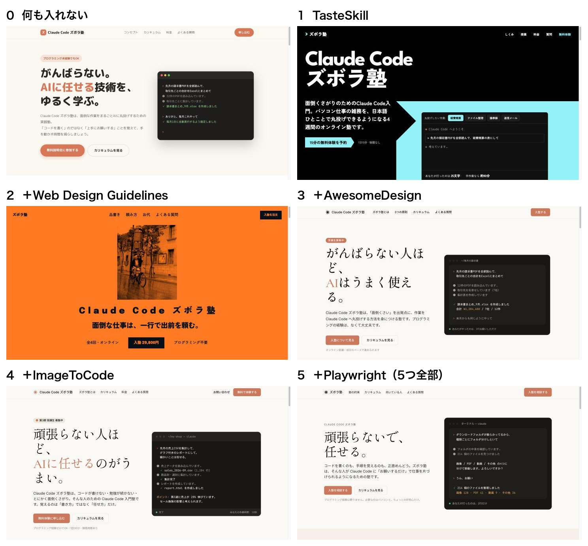

# 「サイトが10倍良くなるプラグイン5つ」の特徴まとめ

Claude Code ズボラ塾のリール（FC12）で「55」とコメントしてくれた方へ。
海外で245万回見られたリールで紹介されていた、5つのプラグインの特徴をまとめました。
それぞれ、僕が実際に入れて試した結果も添えています。

## ひと目で

| | 名前 | ひとことで | 試した結果 |
|---|---|---|---|
| ① | TasteSkill | 上手なサイトのセンスを足す | 一番ガラッと変わった。でも時間もお金も8倍 |
| ② | Web Design Guidelines | 画面をデザインの決まりで点検する | またガラッと変わった。でも頼んでない値段を勝手に書いた |
| ③ | AwesomeDesign | 有名サイトの色と字の決まりをまねる | Claude の公式サイト風に。でも見出しが変な所で切れた |
| ④ | ImageToCode | 見本の絵からサイトを作る | 先に絵を描く道具が必要。③とほぼ同じ |
| ⑤ | Playwright CLI | Claude が自分で画面を開いて確かめる | 僕の所では動かなかった |

## ① TasteSkill（テイストスキル）

- **何をするか**：「いかにも AI が作った」ような、ありきたりな見た目をやめさせるスキル。賞をとったサイトなど247件を調べて作った「見せ方の引き出し」から、題材に合う方向（構成・字・色・写真の使い方）を選んで作る
- **得意なこと**：紹介ページ・商品ページ・ポートフォリオなど、人に見せる1枚もの。作ったあと、画面を撮って見直し、直すところまでやる
- **向く人**：人に見せる1枚もののページを、時間をかけてでも思い切り変えたい人
- **向かない人**：早く・安く作りたい人。何度も作り直したい人
- **気をつける所**：調べて・作って・見直すので、時間とお金がかかる
- **試した結果**：何も入れない時の 1分30秒 → **12分31秒**。料金も約55円 → 約420円。見た目は一番変わった（黒地に大きな字）
- **置き場**：[leonxlnx/taste-skill](https://github.com/leonxlnx/taste-skill)（`skills/taste-skill` を作業フォルダの `.claude/skills/` に入れる）
- [できたページ](images/1_tasteskill.jpg)

## ② Web Design Guidelines（ウェブデザイン・ガイドライン）

- **何をするか**：Vercel（サイトの置き場を作っている会社）が出している「画面づくりの決まり」の一覧で、作った画面を点検するスキル。読みやすさ・押しやすさ・見る人への配慮などを、決まりに沿って1つずつ見る
- **得意なこと**：できた画面の弱い所を、出す前に見つける
- **向く人**：できたページを、出す前に人の目の代わりに点検してほしい人
- **向かない人**：書かれた中身を自分で確かめる時間がない人（勝手に書きかえることがある）
- **気をつける所**：点検のたびに、決まりの一覧をネットから取りにいく。点検だけのつもりでも、中身まで書きかえることがある
- **試した結果**：①と合わせて入れたら、またガラッと変わった。でも、頼んでいない「入塾 29,800円」を勝手に書いた。**出す前に、書かれた中身は自分で確かめる**
- **置き場**：[vercel-labs/agent-skills](https://github.com/vercel-labs/agent-skills)（`skills/web-design-guidelines` を `.claude/skills/` に入れる）
- [できたページ](images/2_web-design-guidelines.jpg)

## ③ AwesomeDesign（オーサム・デザイン）

- **何をするか**：有名なサイト84件の「デザインの決まり」（色・字・余白・ボタンなど）を、1枚ずつの説明書（DESIGN.md）にまとめた集まり。スキルではなく、決まりを書いたファイル
- **得意なこと**：「このサイトみたいな雰囲気で」を、まとめて伝えられる。Apple・Airbnb・Claude など
- **向く人**：「Apple みたいに」「Claude みたいに」と、好きなサイトの雰囲気が決まっている人
- **向かない人**：自分だけの見た目を作りたい人（まねる元に寄る）
- **気をつける所**：作業フォルダに DESIGN.md を置いて、CLAUDE.md に「見た目は DESIGN.md に従う」と書く必要がある。まねる元のサイトの雰囲気に寄る
- **試した結果**：①②に足して、Claude の決まりを使ったら、Claude の公式サイトのような落ち着いた見た目に。時間は 3分24秒。ただ、見出しが「人ほ／ど、」のように変な所で切れた
- **置き場**：[VoltAgent/awesome-design-md](https://github.com/VoltAgent/awesome-design-md)（使ったのは `design-md/claude/DESIGN.md`）
- [できたページ](images/3_awesome-design.jpg)

## ④ ImageToCode（イメージ・トゥ・コード）

- **何をするか**：先にサイトの見本の絵を作り、その絵をよく見て、絵どおりのサイトを作るスキル
- **得意なこと**：見た目にこだわるページを、絵に近い形で仕上げる
- **向く人**：先に見本の絵を作れる道具（Codex など）を持っている人
- **向かない人**：Claude Code だけで作る人（絵が作れず、力が出ない）
- **気をつける所**：もとは Codex（ChatGPT の作業道具）向けに書かれていて、**絵を描く道具が別に要る**。Claude Code だけでは、本当の力は出せない
- **試した結果**：①〜③に足して試した。絵が作れないので、③とほぼ同じ見た目になった。時間は 2分46秒
- **置き場**：[Leonxlnx/imagegen-skills](https://github.com/Leonxlnx/imagegen-skills)（`skills/image-to-code` を `.claude/skills/` に入れる）
- [できたページ](images/4_image-to-code.jpg)

## ⑤ Playwright CLI（プレイライト CLI）

- **何をするか**：Microsoft が作った、ブラウザを動かす道具。Claude が自分でページを開いて、押したり、画面を撮ったりして、崩れていないか確かめられる
- **得意なこと**：できたページを、人の代わりに開いて見る。スマホの幅で崩れていないか、なども確かめられる
- **向く人**：スマホの幅で崩れていないかなど、できたページを Claude に自分で開いて確かめさせたい人
- **向かない人**：パソコンに道具を入れるのが不安な人。ログインしたままのサイトを使っている人
- **気をつける所**：プログラム本体（Node.js 18 以上）を入れる必要がある。ブラウザを動かすので、**ログインしたままのサイトは開かせない**
- **試した結果**：①〜④に足して試した。僕の所（制限をかけた環境）ではブラウザが開けず、動かなかった。5つ全部入りで 2分01秒、見た目は③とほぼ同じ
- **置き場**：[microsoft/playwright-cli](https://github.com/microsoft/playwright-cli)（本体を入れてから、`skills/playwright-cli` を `.claude/skills/` に入れる）
- [できたページ](images/5_all.jpg)

## 僕の答え

**変わるのと、良くなるのは別。**
何も入れずに作っても、1分30秒・約55円で、もう十分きれいでした（[できたページ](images/0_none.jpg)）。
まず何も入れずに作って、気に入らない所だけ、合うプラグインを1つずつ足せばいい。

---
- どれも1回ずつ試した結果です。同じお願いでも、作るたびに見た目は少し変わります
- 6回とも同じプロンプト「Claude Code ズボラ塾の紹介ページを作って」で作りました
- ①から順に、前のプラグインに1つずつ足して試しました（⑤は5つ全部入り）
- 円は1ドル＝約153円の目安です
- 入れる前に、それぞれの説明（README）と決まり（LICENSE）を読んでください

Claude Code ズボラ塾｜ひで（Instagram @claudecode_chefhide）
Claude Code を始めた非エンジニアへ。詰まった所は、直し方ごと見せます。
